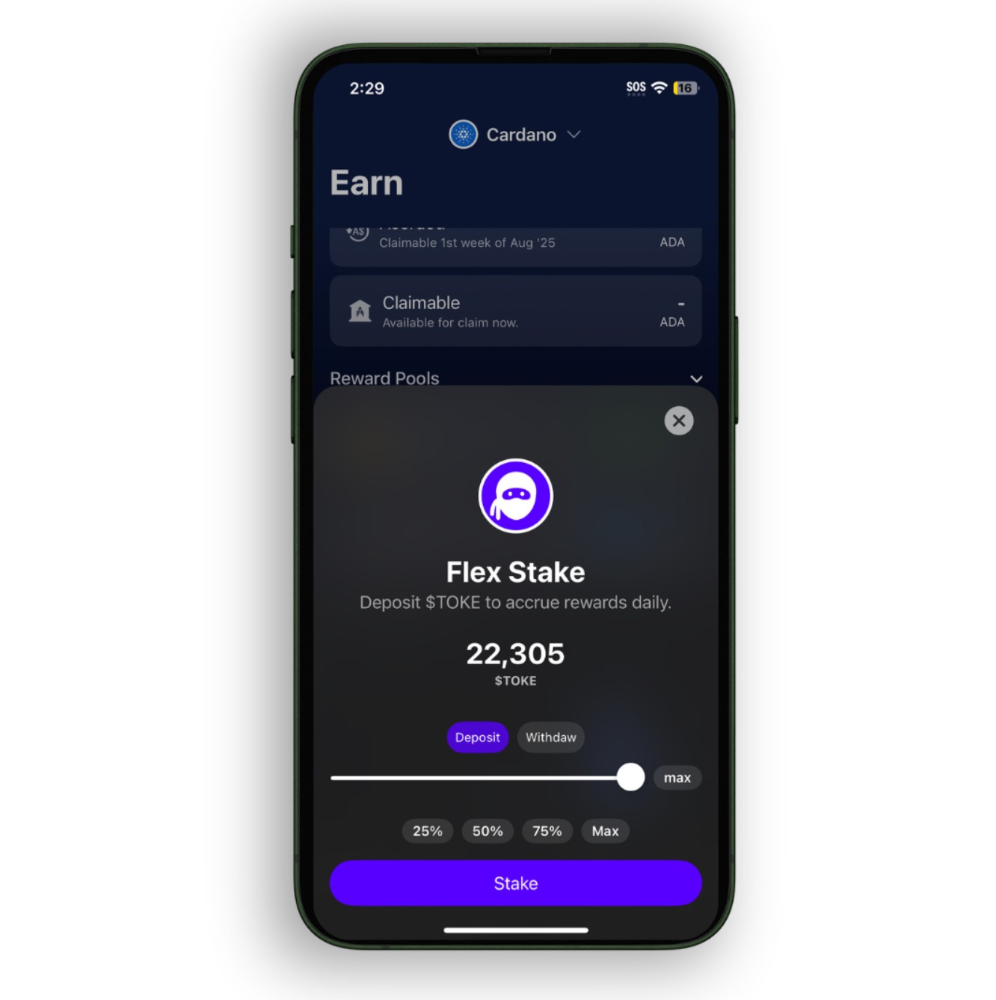
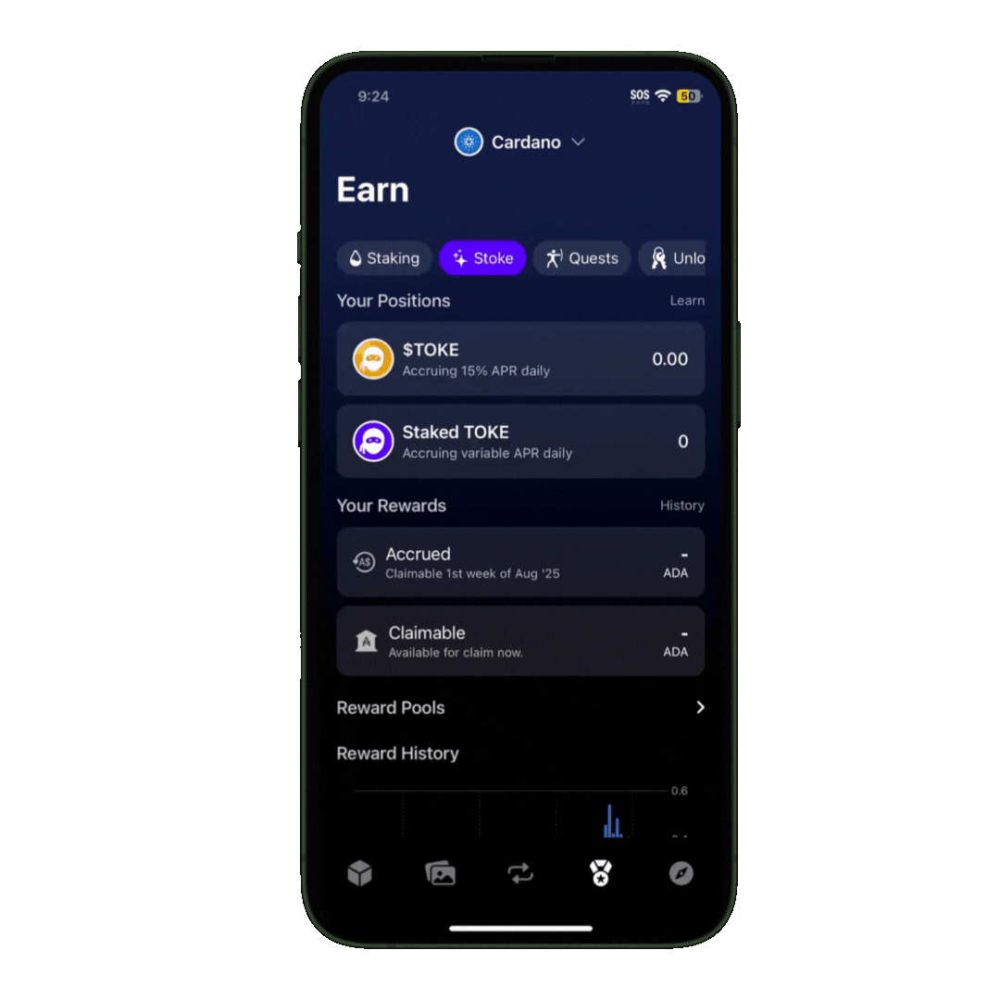

# 🔄 **Flexステーキング**  

Flexステーキングは、プールサイズ上限なし・変動報酬制で、柔軟に$TOKEをステーキングし報酬を得る方法です。

Primeステーキングとは異なり、Flexステーキングでは$STOKEトークンは受け取りません。その代わりに、$TOKEはプール内にロックされ、全体のステーキング額に対する自身のシェアに基づいて報酬が発生します。

---

## 🔑 主な特徴

- **プールサイズ上限なし**  
ステーキング可能な$TOKEに上限はありません。誰でもいつでも参加・退出が可能で、コミュニティの規模に応じてプールは拡大します。

- **変動報酬**  
報酬プールのサイズと自身のステーク比率に応じて、日々報酬額（ADA）が変動します。

- **直接ステーキング**  
$TOKEを直接ステークし、リキッドステーキングトークンは発行されません。

---

## 💸 報酬計算

毎日UTC午前0時にすべてのステーキング状況のスナップショットが取得され、報酬が分配されます。

報酬はADAで支払われ、ステークされた$TOKEの総額に対するあなたのシェアに基づいて配分されます。

### 計算式:

`日次報酬 = (自身のステーク量 ÷ 総ステーク量) × 日次報酬プール（ADA）`

### 計算例:

| 例 | あなたの$TOKE | 総ステーク$TOKE | 日次報酬プール (ADA) | 日次報酬 (ADA) | 月間報酬 (ADA) |
|----|----------------|-------------------|-------------------------|----------------|------------------|
| 1  | 100,000        | 10,000,000        | 50                      | 0.5            | ~15              |
| 2  | 500,000        | 8,000,000         | 80                      | 5              | ~150             |
| 3  | 1,000,000      | 20,000,000        | 100                     | 5              | ~150             |

報酬は、ステーキングしているウォレットのアドレスに付与されます。

---

## 📤 報酬の請求

- **蓄積**: プールに対する自身のシェアに基づいて毎日報酬が加算されます  
- **請求可能タイミング**: 毎月第1週に1度オンチェーンで請求可能  
- **確認方法**: Tokeoアプリで蓄積済み・請求可能な報酬額を確認できます  
- **処理方法**: すべての請求はオンチェーンで処理され、透明性が確保されます  
- **最低請求額**: 最低5 ADAに達すると請求が可能です  

## 📝 Flexステーキングの始め方

### ステップバイステップ:

1. **Tokeoアプリをダウンロード**（iOS/Android対応）  
2. **ウォレットを設定**（Cardano互換ウォレットを接続）  
3. **$TOKEを入手**（購入または転送）  
4. **Rewardsタブ内の「Earn」セクションを開く**  
5. **Flexステーキングを選択**し、金額を入力して確定  

