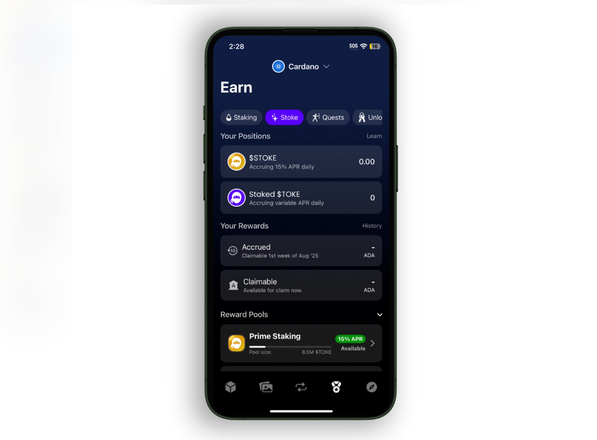

# **💰Tokeo報酬プログラム**  
$TOKEをステーキングして報酬を獲得

Tokeo報酬プログラムは、Tokeo Rewards Engine（TRE）によって支えられており、Tokeoの保有者や利用者が、$TOKEをステーキングすることで直接報酬を得ることができます。

この報酬プログラムには、以下の3つの主要な要素があります：

- [**Prime（流動性）ステーキング（固定APR）**](./prime.md)  
$TOKEを上限付きプールにステーキングすることで、年率15％の固定リターンを提供。代わりにリキッドトークンである$STOKEを受け取ります。

- [**Flexステーキング（変動APR）**](./flex.md)  
プール制限や $STOKE トークンの発行なしで、ステークされた合計 $TOKE の割合に基づいて変動する毎日の報酬を提供します。

- [**Tokeo XP（TXP）プログラム**](./xp.md)  
アプリ内のゲーミフィケーションシステムで、特定のタスクの実行やTokeoに関する学習、他者の参加促進などでポイントを獲得できます。
