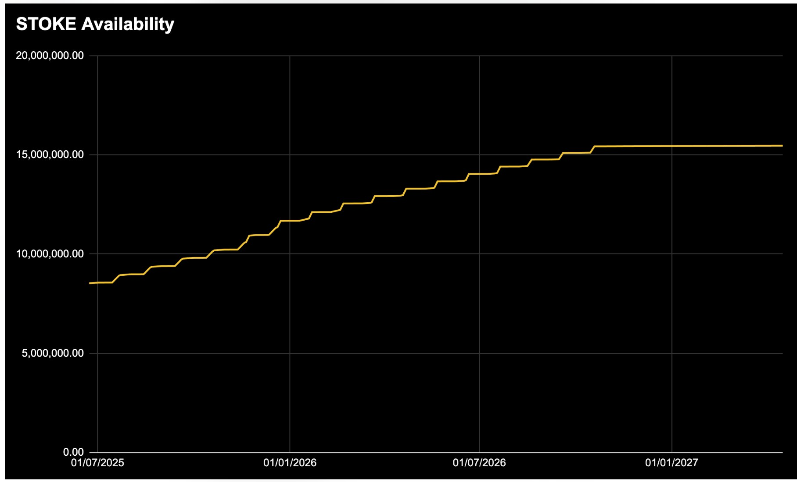
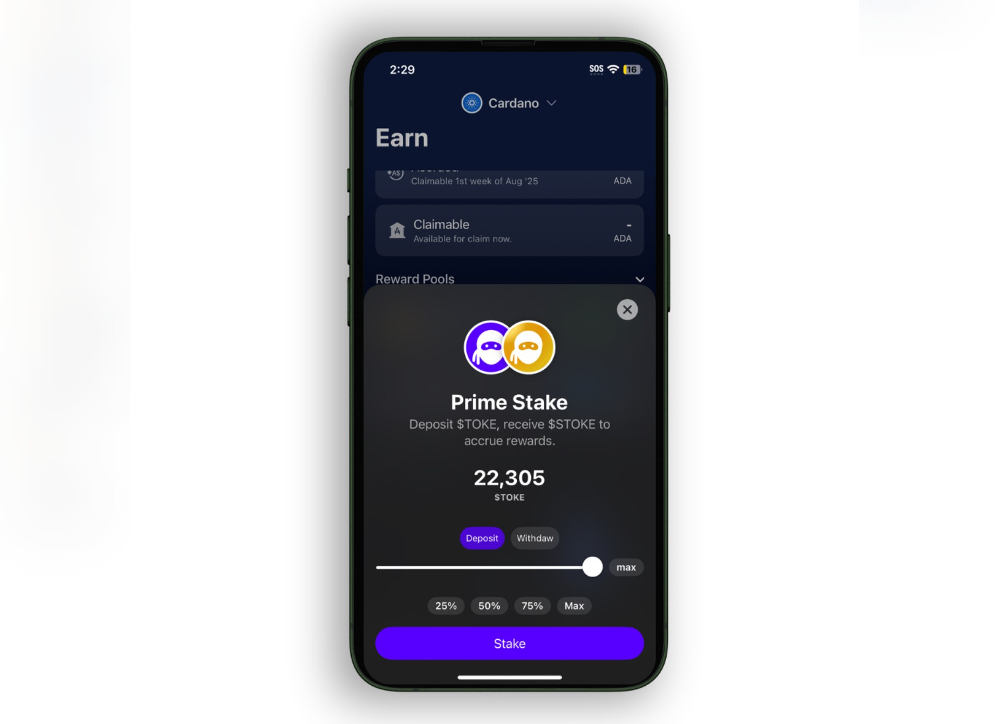

# 🌟 **Primeステーキング**  

Primeステーキングでは、ステーキングした$TOKEに対して年率15％（APR）のリターンが提供されます。

Primeステーキングは、$TOKEの流通供給量の20%を上限とするステーキングプールであり、オンチェーンのスマートコントラクトによって透明性とセキュリティが確保されています。

$TOKEをPrimeステーキングに預けると、代わりに$STOKEトークンを受け取ります。これを「リキッドステーキング」と呼び、流動性を維持しながら報酬を得ることができます。

---

## 🔑 主な特徴

- **1:1の交換レート**  
　ステーキングコントラクトは、$TOKEと$STOKEの間の常に一定の1:1交換レートを維持します。1 $STOKEは常に1 $TOKEに交換可能です。

- **変動プールサイズ**  
　$STOKEの供給量は$TOKEの流通量に直接リンクしています。ベスティングスケジュールにより$TOKEの供給が増えると、利用可能な$STOKEも増え、プライムステーキングプールも比例して増加します。

- **$STOKEのポリシーID**  
　`bea9c296e7de1ad91f85f52350a904c2940770598004e4d62a07a578`

## 💸 報酬計算

- 毎日UTC午前0時にスナップショットが撮られ、$STOKE保有者は年率15%でADAによる報酬を受け取ります（将来的に他通貨での支払いも予定）

### 計算式:

`日次報酬 = $STOKE保有数 × 現在の$TOKE価格（ADA） × (15% ÷ 365)`

### 計算例:

- **$STOKE保有量**: 50,000  
- **$TOKE価格**: 0.042 ADA  
- **日次報酬**: `50,000 × 0.042 × (15 ÷ 365)% = 約0.863 ADA`  
- **月間報酬**: 約26.25 ADA  
- **年間報酬**: 約315 ADA  

| $STOKE量 | $TOKE価格 (ADA) | 日次報酬 | 月間報酬 | 年間報酬 |
|---------|----------------|----------|----------|----------|
| 10,000  | 0.035          | 0.144 ADA | 4.375 ADA | 52.5 ADA |
| 100,000 | 0.050          | 2.055 ADA | 62.5 ADA  | 750 ADA  |
| 250,000 | 0.030          | 3.424 ADA | 93.75 ADA | 1,125 ADA |

報酬は、$STOKEを保有するウォレットのステーキングアドレスに入金されます。

---

## 📤 報酬の請求

- **蓄積**: 報酬は毎日$STOKE保有量に基づいて自動的に加算されます  
- **請求可能タイミング**: 毎月第1週に請求可能になります  
- **確認方法**: Tokeoモバイルアプリで確認できます  
- **処理方法**: 請求はオンチェーンで処理され、透明性が保たれます  
- **最低請求額**: 報酬が5ADA以上に達すると請求可能  

## 📝 Primeプールへのステーキング方法

### ステップバイステップ:

1. **Tokeoアプリをダウンロード**（iOS/Android対応）  
2. **ウォレットを設定**（Cardano互換ウォレット）  
3. **$TOKEを入手**（購入または転送）  
4. **Rewardsタブ内の「Earn」セクションを開く**  
5. **Primeステーキングを選択**し、金額を入力して確定  
6. **$STOKEを受け取る**（即時ウォレットに反映）  
